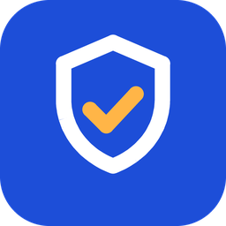
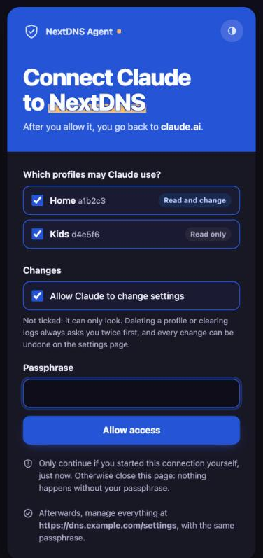
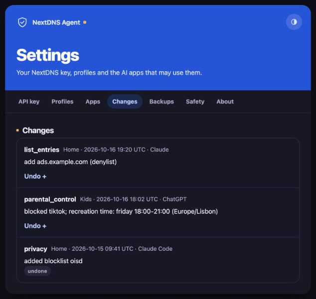
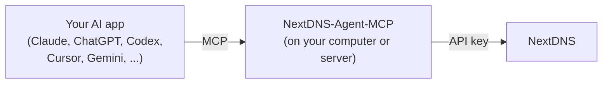
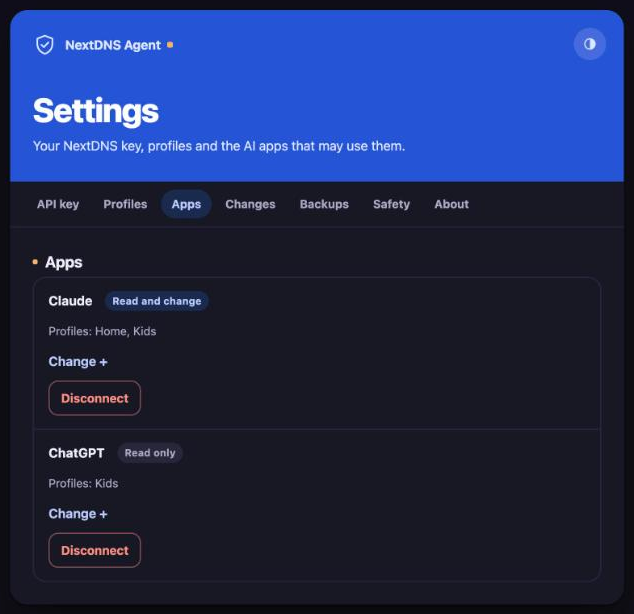

<p align="center"></p>

<h1 align="center">NextDNS-Agent-MCP</h1>

<p align="center"><b>Your NextDNS account inside any AI app or agent: Claude, ChatGPT, Codex, Cursor, Gemini, OpenClaw, Hermes, Goose and more.<br>On your computer and on your phone. Self-hosted, with undo for every change.</b></p>

<p align="center">
<a href="LICENSE"></a>
<a href="pyproject.toml"></a>
<a href="https://modelcontextprotocol.io"></a>
<a href="docs/connect-your-ai.md"></a>
<a href="#choose-how-to-run-it"></a>
<br>
<a href="https://github.com/s17sh70x2jfl031ag/NextDNS-Agent-MCP/actions/workflows/tests.yml"></a>
<a href="https://github.com/s17sh70x2jfl031ag/NextDNS-Agent-MCP/releases/latest"></a>
<a href="https://github.com/s17sh70x2jfl031ag/NextDNS-Agent-MCP/commits/main"></a>
</p>

<p align="center">
<a href="#quick-start-about-5-minutes">Quick start</a> ·
<a href="#choose-how-to-run-it">Ways to run it</a> ·
<a href="docs/connect-your-ai.md">Connect your AI app</a> ·
<a href="docs/safety.md">Safety</a> ·
<a href="#all-the-guides">All guides</a>
</p>

> [!NOTE]
> Not made by or affiliated with NextDNS. It uses the public [NextDNS API](https://nextdns.github.io/api/) with your own API key.

<table align="center"><tr>
<td align="center"><br><sub>Choose which profiles each AI app may use</sub></td>
<td align="center"><br><sub>Every change, with an Undo button</sub></td>
</tr></table>

Ask your AI app about your DNS in plain words. It looks at your stats and logs, and changes your blocklists, parental control and settings for you. Every change can be undone, and deleting things always asks you twice.

```
You: What got blocked on my phone today, and why?
AI:  Reads your NextDNS log: 214 blocked, mostly trackers from OISD, and one site
     from your denylist. Shows a chart.

You: My son's game doesn't load. Find out why and fix it.
AI:  Watches the live log while he opens it, sees roblox.com blocked by the
     "gaming" category, and asks if it should allow it on weekends only.

You: Block TikTok on the Kids profile, except Friday 6 to 9 pm.
AI:  Blocks TikTok and sets recreation time. Says how to undo it.
```

## How it works

The server is a small program you run yourself. Your AI app talks to it through **MCP** (Model Context Protocol), the standard way AI apps use outside tools. The server talks to NextDNS through its official API, with your API key. Nobody else is in between: no account, no cloud service of ours, no tracking.



More in [docs/how-it-works.md](docs/how-it-works.md).

## Words you'll see

| Word | What it means here |
|---|---|
| **Profile** | A NextDNS configuration (its lists, protections and settings). Devices use a profile through its address. |
| **API key** | The key that lets this server read and change your NextDNS account. It's at the bottom of [my.nextdns.io/account](https://my.nextdns.io/account). |
| **Mode** | What the AI may do with a profile: **full** (read and change), **read** (read only) or **hidden**. |
| **Passphrase** | A password you make up for the web version. It locks the settings page, and you type it once when you connect an AI app over the internet. |
| **MCP** | How AI apps plug into tools like this one. |
| **Settings file** | `~/.config/nextdns-agent-mcp/.env` on a computer. Hosting companies use their own "Variables" page instead. |
| **Data folder** | Where the server keeps its own files (change log, logins, backups): `~/.config/nextdns-agent-mcp/state` on a computer, `/data` in Docker and on hosting companies. |

## Choose how to run it

|  | Where it runs | Works on your phone | Cost | Guide |
|---|---|---|---|---|
| **Claude Desktop extension** | Your computer, inside Claude Desktop | No | Free | [claude-desktop-extension.md](docs/claude-desktop-extension.md) |
| **1. Your computer** | Mac, Windows or Linux, for any AI app on it | Only with a tunnel | Free | [setup-computer.md](docs/setup-computer.md) |
| **2. A hosting company** | Railway, Render or any host that runs Docker | Always | A few dollars a month | [setup-hosting.md](docs/setup-hosting.md) |
| **3. Your own server** | Any server with Docker | Always | Free to cheap | [setup-own-server.md](docs/setup-own-server.md) |

<a href="https://railway.com/deploy/nextdns-agent-mcp"></a> <a href="https://render.com/deploy?repo=https://github.com/s17sh70x2jfl031ag/NextDNS-Agent-MCP"></a>

> [!TIP]
> Not sure? Start with **1**, free, on your computer. Move to **2** when you want it on your phone all the time.
>
> Using an AI coding agent like Claude Code, Codex or Cursor? Ask it to set this up for you: [AGENTS.md](AGENTS.md#deploying-for-a-user) gives it a checklist.

## What it can do

**Look.** Your profiles and every setting in plain words. Analytics: allowed and blocked, top domains, block reasons, devices, IPs, protocols, query types, DNSSEC, encryption, countries and big tech companies, for any time span and also over time. Charts as pictures. The query log, searched and filtered, or downloaded.

**Find out why.** `check_domain` makes a real DNS query through the profile and tells you if a domain is blocked, and by what: the denylist, a blocklist, a category. `watch_logs` watches queries live while you open an app.

**Change.** The denylist and allowlist (many at once), privacy blocklists and native tracker protection, every security protection and blocked TLDs, parental control (services, categories, safe search, YouTube restricted mode, recreation time), DNS rewrites, logs, block page and performance settings. Everything the NextDNS API allows.

**Profiles.** Create a profile (with NextDNS's usual protections, empty, or as a copy of another), compare two profiles, rename them.

**Undo.** Every change is saved with how things were before. Ask *"undo that"*, or press Undo on the settings page.

**Backups.** Save a full copy of a profile, download it as a file, and put it back later, or make a new profile from it.

**Ask twice.** Deleting a profile, clearing logs and overwriting a profile from a backup need a double confirmation: the AI must ask you and get a yes first.

**Updates, if you want them.** Get told when there's a new release, or let it update itself, official releases only. See [docs/updates.md](docs/updates.md).

**A settings page.** On the web version, open `/settings` to paste your API key, choose what the AI may do with each profile, see and disconnect AI apps, undo changes, and manage backups.

All 23 tools: [docs/tools.md](docs/tools.md). Ideas for what to ask: [docs/examples.md](docs/examples.md).

## Safety and privacy

- **Your choice, per profile:** full, read only or hidden. Hidden profiles are never shown to the AI.
- **Your choice, per app:** each AI app connected over the internet gets only the profiles you tick, with or without changes.
- **Undo for every change,** and a double confirmation for anything that deletes or overwrites.
- **A brake:** at most 30 changes a minute, and a read-only switch for everything.
- **Your key stays yours:** it goes only to NextDNS, and is stored encrypted when you paste it on the settings page.

More in [docs/safety.md](docs/safety.md) and [docs/privacy.md](docs/privacy.md).

<p align="center"></p>

## Quick start (about 5 minutes)

1. Install [uv](https://docs.astral.sh/uv/getting-started/installation/), a small free tool that installs Python programs.
2. Install the server:

   ```bash
   uv tool install git+https://github.com/s17sh70x2jfl031ag/NextDNS-Agent-MCP
   ```

3. Get your API key: sign in at [my.nextdns.io/account](https://my.nextdns.io/account), scroll to the bottom (**API**), show the key and copy it.
4. Save it in the settings file:

   ```bash
   mkdir -p ~/.config/nextdns-agent-mcp
   ```

   ```bash
   echo "NEXTDNS_API_KEY=paste-your-key-here" > ~/.config/nextdns-agent-mcp/.env
   ```

5. Check it. It lists your profiles and changes nothing:

   ```bash
   nextdns-agent-mcp check
   ```

6. Connect your AI app. For example Claude Code:

   ```bash
   claude mcp add -s user nextdns -- nextdns-agent-mcp stdio
   ```

   For Claude Desktop, ChatGPT, Codex, Cursor, VS Code, Gemini CLI, OpenClaw, Hermes Agent, Goose, Cline, Roo Code, Continue, Windsurf, Zed, LM Studio, OpenCode, Kiro, GitHub Copilot CLI, Amp, Warp, JetBrains AI Assistant, Qwen Code, Crush, Augment Code and any other MCP app, see [docs/connect-your-ai.md](docs/connect-your-ai.md).

7. Ask your AI: *"Use the NextDNS tools: what got blocked today?"*

## All the guides

| Guide | Read it when |
|---|---|
| [Claude Desktop extension](docs/claude-desktop-extension.md) | You use Claude Desktop and want one click |
| [Setup on your computer](docs/setup-computer.md) | You want to try it, free, with any AI app |
| [Setup on a hosting company](docs/setup-hosting.md) | You want it on your phone, always on |
| [Setup on your own server](docs/setup-own-server.md) | You have a server with Docker |
| [Connect your AI app](docs/connect-your-ai.md) | The server runs and you want to use it |
| [Profiles and apps](docs/profiles.md) | You want to choose what the AI may see and change |
| [Every tool](docs/tools.md) | You want to know what it can do |
| [Things to ask](docs/examples.md) | You want ideas |
| [Undo and backups](docs/undo-and-backups.md) | Something changed and you want it back |
| [Every setting](docs/settings.md) | You want to change modes, limits or ports |
| [Safety](docs/safety.md) | Before you let an AI change your DNS |
| [Privacy](docs/privacy.md) | You want to know what is kept and where |
| [How it works](docs/how-it-works.md) | You want to know how it works inside |
| [Languages](docs/languages.md) | You want the pages in your language |
| [Updates](docs/updates.md) | You want the newest version |
| [Questions people ask](docs/faq.md) | You have a quick question |
| [Troubleshooting](docs/troubleshooting.md) | Something doesn't work |
| [Roadmap](docs/roadmap.md) | You want to know what's planned |
| [CHANGELOG.md](CHANGELOG.md) | You want to know what changed in each version |
| [CONTRIBUTING.md](CONTRIBUTING.md) | You want to report a bug or send a fix |
| [AGENTS.md](AGENTS.md) | You (or your AI coding agent) want to change the code or set it up |

## Help and feedback

| You want to | Go to |
|---|---|
| Fix a problem yourself | [Troubleshooting](docs/troubleshooting.md) |
| Report a bug | [Something doesn't work](https://github.com/s17sh70x2jfl031ag/NextDNS-Agent-MCP/issues/new?template=bug_report.yml) |
| Ask a question or share an idea | [Question](https://github.com/s17sh70x2jfl031ag/NextDNS-Agent-MCP/issues/new?template=question.yml) |
| Report a security problem, privately | [Private report](https://github.com/s17sh70x2jfl031ag/NextDNS-Agent-MCP/security/advisories/new) ([SECURITY.md](SECURITY.md)) |

Issues are public, so leave out your API key, profile IDs and anything from your logs.

## Credits

NextDNS-Agent-MCP was made by [s17sh70x2jfl031ag](https://github.com/s17sh70x2jfl031ag). NextDNS is a trademark of its owners; this project isn't made by or affiliated with them.

GitHub's "Cite this repository" button uses [CITATION.cff](CITATION.cff).

## License

[Apache License 2.0](LICENSE), with the notices in [NOTICE](NOTICE). Copyright 2026 s17sh70x2jfl031ag and NextDNS-Agent-MCP contributors.
