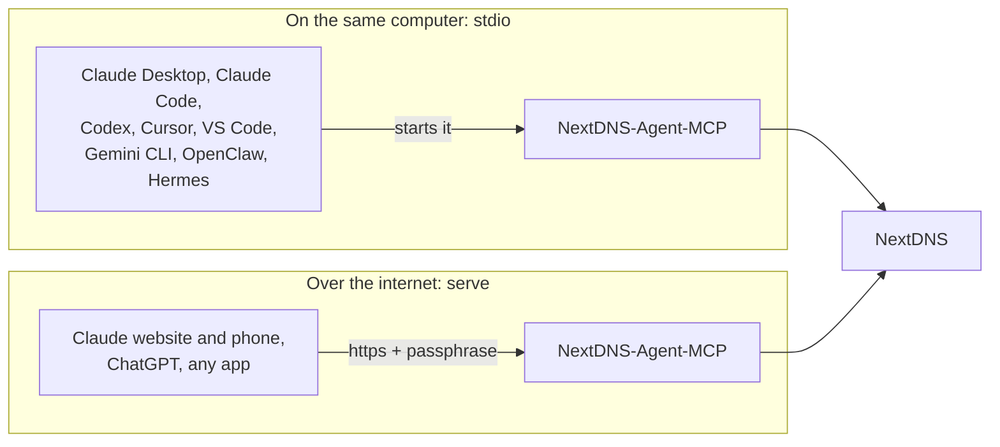

# Connect your AI app

Any app that speaks MCP can use this server. There are two ways it can reach it:

- **On the same computer (`stdio`).** The app starts its own small copy of the server. No login and no web address needed. You need [the computer setup](setup-computer.md) done (the API key in the settings file).
- **Over the internet (`serve`).** The app connects to `https://your-address/mcp` and you log in once with your passphrase, ticking which profiles it may use. You need [a hosting company](setup-hosting.md), [your own server](setup-own-server.md), or your computer with a tunnel.



Menus in these apps change often. If a label below doesn't match what you see, look for "MCP", "Connectors" or "Tools" in the app's settings.

| App | Same computer | Over the internet |
|---|---|---|
| [Claude Code](#claude-code) | Yes | Yes |
| [Claude Desktop](#claude-desktop) | Yes, or the [extension](claude-desktop-extension.md) | Yes, via claude.ai |
| [Claude website and phone app](#claude-website-and-phone-app) | No | Yes |
| [ChatGPT](#chatgpt) | No | Yes |
| [Codex](#codex) | Yes | Yes |
| [Cursor](#cursor) | Yes | Yes |
| [VS Code (Copilot)](#vs-code) | Yes | Yes |
| [Gemini CLI](#gemini-cli) | Yes | Yes |
| [OpenClaw](#openclaw) | Yes | Yes |
| [Hermes Agent](#hermes-agent) | Yes | Yes |
| [Any other MCP app](#any-other-mcp-app) | Usually | If it supports MCP login (OAuth) |

**What we tested:** both ways end to end with the official MCP Python client against a real NextDNS account (the login page, tokens, listing the tools and calling them), and the Claude Desktop extension started the way Claude Desktop starts it. The app-by-app settings below follow each app's own documentation; tell us in an [issue](https://github.com/s17sh70x2jfl031ag/NextDNS-Agent-MCP/issues/new?template=question.yml) if one has changed.

## Before you start: the command path

Desktop apps sometimes can't find commands that your terminal finds. Get the full path once:

- Mac and Linux: `which nextdns-agent-mcp` (usually `/Users/you/.local/bin/nextdns-agent-mcp`)
- Windows: `where nextdns-agent-mcp`

Use that full path wherever you see `/full/path/to/nextdns-agent-mcp` below.

## Claude Code

Same computer:

```bash
claude mcp add nextdns -s user -- nextdns-agent-mcp stdio
```

Over the internet:

```bash
claude mcp add nextdns -s user --transport http https://your-address/mcp
```

Then run `/mcp` inside Claude Code, choose `nextdns` and log in.

## Claude Desktop

The easiest way is the [Claude Desktop extension](claude-desktop-extension.md): open one file, paste your API key, done.

Already installed the command ([computer setup](setup-computer.md))? Settings → Developer → **Edit Config** opens `claude_desktop_config.json`. Add:

```json
{
  "mcpServers": {
    "nextdns": {
      "command": "/full/path/to/nextdns-agent-mcp",
      "args": ["stdio"]
    }
  }
}
```

Save, then quit and reopen Claude Desktop. To use the internet version instead, add it on the Claude website (below): connectors you add there also show up in Claude Desktop.

## Claude website and phone app

You add the connector on the website, and the phone app picks it up.

1. On [claude.ai](https://claude.ai), open **Settings → Connectors**.
2. Click **Add custom connector**. Name: `NextDNS`. URL: `https://your-address/mcp`.
3. Click **Connect**. The login page opens: tick the profiles Claude may use, choose whether it may change settings, type your passphrase and click **Allow access**.
4. In a chat, turn the connector on from the tools menu.
5. Open the Claude phone app: the connector is already there.

> [!TIP]
> In the connector's settings you can set tools to **Always ask**. Deleting and overwriting already ask twice on their own, but you can make any change wait for your tap.

## ChatGPT

ChatGPT connects over the internet, through **developer mode**. Which plans can use it, and whether it allows changes (write actions), changes over time: check [OpenAI's developer mode page](https://help.openai.com/en/articles/12584461) for your plan.

1. **Settings → Apps & Connectors → Advanced settings →** turn on **Developer mode**.
2. **Create** a connector. URL: `https://your-address/mcp`. Authentication: **OAuth**.
3. Save, then tick the profiles and type your passphrase on the login page that opens.

## Codex

Same computer:

```bash
codex mcp add nextdns -- nextdns-agent-mcp stdio
```

Over the internet:

```bash
codex mcp add nextdns --url https://your-address/mcp
```

```bash
codex mcp login nextdns
```

Both write to `~/.codex/config.toml`, which you can also edit by hand:

```toml
[mcp_servers.nextdns]
command = "nextdns-agent-mcp"
args = ["stdio"]
```

## Cursor

In `~/.cursor/mcp.json` (or Settings → MCP → Add):

```json
{
  "mcpServers": {
    "nextdns": { "command": "/full/path/to/nextdns-agent-mcp", "args": ["stdio"] }
  }
}
```

Over the internet, use `"nextdns": { "url": "https://your-address/mcp" }` instead.

## VS Code

Run **MCP: Add Server** from the command palette, or put this in `.vscode/mcp.json`:

```json
{
  "servers": {
    "nextdns": { "type": "stdio", "command": "/full/path/to/nextdns-agent-mcp", "args": ["stdio"] }
  }
}
```

Over the internet, use `"nextdns": { "type": "http", "url": "https://your-address/mcp" }`.

## Gemini CLI

In `~/.gemini/settings.json`:

```json
{
  "mcpServers": {
    "nextdns": { "command": "nextdns-agent-mcp", "args": ["stdio"] }
  }
}
```

Over the internet, use `"nextdns": { "httpUrl": "https://your-address/mcp" }`.

## OpenClaw

In `~/.openclaw/openclaw.json` (or Settings → MCP in the OpenClaw app, or `openclaw mcp add`):

```json5
{
  mcp: {
    servers: {
      nextdns: { command: "/full/path/to/nextdns-agent-mcp", args: ["stdio"] }
    }
  }
}
```

Over the internet, use `nextdns: { url: "https://your-address/mcp", transport: "streamable-http", auth: "oauth" }`, then run `openclaw mcp login nextdns` and type your passphrase in the browser. If you use OpenClaw's **Sign in** button instead, the login returns to your OpenClaw address, so add that address to `ALLOWED_REDIRECT_HOSTS` ([below](#if-the-login-page-refuses-your-app)).

> [!WARNING]
> OpenClaw runs tools without asking, by default. To be asked before each change, run `openclaw mcp configure nextdns --approval prompt`.

## Hermes Agent

In `~/.hermes/config.yaml` (or with `hermes mcp add`):

```yaml
mcp_servers:
  nextdns:
    command: "/full/path/to/nextdns-agent-mcp"
    args: ["stdio"]
```

Over the internet:

```yaml
mcp_servers:
  nextdns:
    url: "https://your-address/mcp"
    auth: oauth
```

Run `/reload-mcp` in Hermes (or restart it). It opens the login page in your browser. To log in again later: `hermes mcp login nextdns`.

## Any other MCP app

- **On the same computer:** the command is `nextdns-agent-mcp` with the argument `stdio`. Settings come from `~/.config/nextdns-agent-mcp/.env` or environment variables ([settings.md](settings.md)), so you can also pass `NEXTDNS_API_KEY` in the app's `env` block.
- **Over the internet:** the address is `https://your-address/mcp` (Streamable HTTP), with MCP's standard OAuth login: the app registers itself, then opens the login page.

Without installing anything, `uvx` can run it straight from GitHub:

```json
{ "command": "uvx", "args": ["--from", "git+https://github.com/s17sh70x2jfl031ag/NextDNS-Agent-MCP", "nextdns-agent-mcp", "stdio"],
  "env": { "NEXTDNS_API_KEY": "your-key" } }
```

## Is it working?

Ask your AI: *"Use the NextDNS profiles tool."* It should list your profiles and what it may do with each. If not, see [troubleshooting.md](troubleshooting.md).

## Give it a name in the change log

On the same computer, every app shows as "AI app" in the change log. To tell them apart, set `NEXTDNS_APP_NAME` in the app's `env` block (for example `"Claude Code"`). Over the internet, the app's own name is used.

## If the login page refuses your app

Only apps from a list of known addresses may receive the login: Claude, ChatGPT, OpenAI and VS Code on the web, plus any app on your own computer (localhost), which covers Claude Code, Codex, Cursor, Gemini CLI, OpenClaw's `mcp login` and Hermes. If another app shows "Redirect not allowed", add its domain to `ALLOWED_REDIRECT_HOSTS` ([settings.md](settings.md)).
