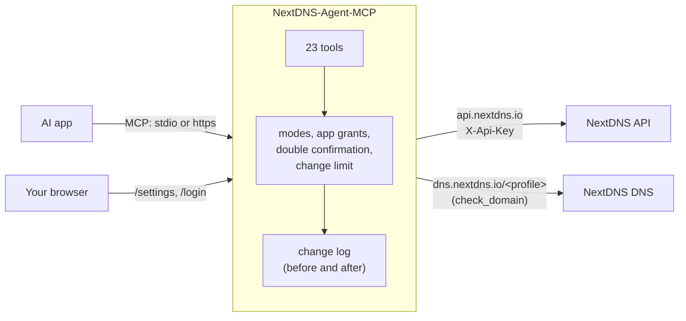

# How it works

## The pieces

- **The AI app** sees a list of tools with descriptions and calls them. It never sees your API key.
- **The server** checks each call against the profile modes, the app's grant and the safety rules, then calls the NextDNS API. Before and after every change it saves that part of the profile, which is what undo uses.
- **NextDNS** does the actual filtering. The server only reads and changes your configuration, like the NextDNS dashboard does.

## Two ways to run

| | `stdio` | `serve` (web version) |
|---|---|---|
| Who starts it | The AI app, on the same computer | You, or your hosting company |
| Login | None (it's your computer) | OAuth with your passphrase, per app |
| Settings page | No | Yes, at `/settings` |
| Address | None | `https://your-address/mcp` |

Both use the same settings file and the same data folder, so the change log and backups are shared between them on one computer.

## A change, step by step

Say you ask *"block tiktok.com"*:

1. The AI calls `list_entries(list_name="denylist", action="add", domains=["tiktok.com"])`.
2. The server finds the profile (by ID, name, the default, or the only one) and checks: is it visible to this app, is it in **full** mode, may this app change things, is read-only mode off, is the change limit not reached.
3. It saves the profile's denylist as it is now.
4. It adds the entry through the API, and checks the answer: NextDNS sometimes reports problems inside an "OK" answer, and those are caught too.
5. It saves the denylist again, and if it changed, writes both versions to the change log with an ID.
6. The AI gets a plain-English answer that ends with *"undo(change_id='...') puts it back"*.

## Asking twice

For deletes and overwrites, step 2 adds a check: the first call does nothing and returns a one-time code with a warning. The AI has to show you the warning and get your yes, then call again with the code. Codes work once, for that one action, for 5 minutes.

## Logins (web version)

The server is its own small OAuth server, for one person: you.

1. The AI app registers itself and opens the login page.
2. The page shows which app is asking and where it will return. You tick the profiles, choose whether it may change things, and type your passphrase.
3. The app gets a key that lasts an hour and renews for up to 90 days. The server keeps only a fingerprint (SHA-256) of each key.
4. Every tool call carries the key; the server looks up that app's grant.

Only known app addresses may receive the login (Claude, ChatGPT, OpenAI, VS Code on the web, and anything on localhost). See [settings.md](settings.md).

## What's stored

All in the data folder, as small JSON files, written owner-only:

| File | What |
|---|---|
| `secrets.json` | The API key from the settings page, encrypted |
| `secret.key` | The encryption key, only when `NEXTDNS_SECRET_KEY` isn't set |
| `settings.json` | Choices made on the settings page |
| `oauth.json` | Connected apps, their grants, key fingerprints |
| `sessions.json` | Settings-page sign-ins you asked to remember (fingerprints) |
| `changes.json` | The change log, last 300 |
| `created.json` | Profiles the AI made |
| `backups/` | Profile backups |

No database, nothing sent anywhere except to NextDNS. More in [privacy.md](privacy.md).

## The code

| File | What it does |
|---|---|
| `server.py` | Settings, the change log and undo, every tool, the commands |
| `api.py` | The NextDNS API client, the live log stream, DNS test queries |
| `auth.py` | The OAuth login and settings-page sessions |
| `web.py`, `pages.py` | The settings and login pages (plain HTML, no scripts) |
| `store.py` | Safe file writing, locks, encryption, passphrase hashing |
| `charts.py` | Charts as PNG pictures |
| `i18n.py`, `locales/` | Ready for translations |

The tests run against a fake NextDNS, so they never touch a real account: `uv run pytest -q`.
