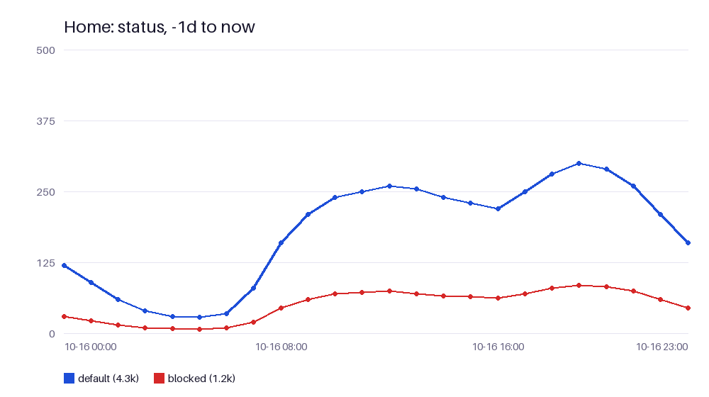

# Tools

23 tools, in three groups. Below each name is the tool's own description, the text your AI app reads, and what it takes. You don't call them yourself: ask in plain words ([examples.md](examples.md)) and the AI picks them.

- **Look** tools only read. Apps can run them without asking.
- **Change** tools change your NextDNS configuration. Each change is saved in the change log and can be undone ([undo-and-backups.md](undo-and-backups.md)).
- **Asks twice first** tools delete or overwrite. The first call only explains and gives a one-time code; the AI must ask you before the second ([safety.md](safety.md#asked-twice)). They're marked as destructive, so most apps also ask on their own. `undo` is marked the same way, because undoing the creation of a profile deletes it.

Dates accept ISO dates (`2026-10-16`), Unix times, or relative times like `-6h`, `-7d`, `-1M` and `now`. Profiles are named by ID or name; with a single visible profile, or a default one, it can be left out.

## Look

### `profiles`

List the NextDNS profiles this app may use: each one's name, ID and mode (read and change, or read only), and
which is the default. Call it first, to learn the names or IDs the other tools take; hidden profiles never
show. Changes nothing: use profile to see one profile's settings.

Takes: nothing.

### `profile`

Show one profile's configuration as text: security, privacy, parental control, denylist, allowlist, rewrites,
settings and setup (the DNS addresses devices use). Use it to see how a profile is set up before changing
it; use compare_profiles to set two side by side and check_domain to know if one domain is blocked. Changes
nothing. Without section, long lists are cut short; an unknown section is refused with the valid ones.

Takes: `profile`, `section`.

### `catalog`

List what NextDNS offers to pick from (privacy blocklists, native tracking protection, parental control services
and categories, or top-level domains), with the IDs that privacy, security and parental_control take. Use it
to find the right ID before a change; use profile to see what a profile already has on. Changes nothing.
Returns how many matched and one line per item (blocklists also with size, update date and description).

Takes: `kind`, `search`, `limit`.

### `analytics`

Count a profile's DNS queries over a time span, one report at a time: allowed or blocked, top domains, block
reasons, devices, IPs, protocols and more. Use chart for the same numbers as a picture, logs for single
queries and watch_logs for queries happening now. Changes nothing. Returns one line per row with its count
(counts over time with series), and a cursor line when there are more rows.

Takes: `report`, `profile`, `from_date`, `to_date`, `device`, `status`, `root`, `destination`, `limit`, `series`, `interval`, `timezone`, `cursor`.

### `chart`

Draw a profile's analytics as a PNG picture: lines over time (up to 6) or bars of the top rows (up to 20), for
the same reports as analytics. Use it when the user wants to see a trend or a ranking; use analytics for
exact numbers and more rows. Changes nothing. Returns a short text with the totals plus the image, or only a
note when there were no queries in that time.

Takes: `report`, `profile`, `over_time`, `from_date`, `to_date`, `device`, `interval`, `timezone`, `status`, `limit`.

### `logs`

Search a profile's query log: single DNS queries, newest first, one line each with time (UTC), status, domain,
device and block reason. Use it to see what a device looked up or why something was blocked earlier; use
watch_logs for queries happening now, analytics for totals and check_domain to test one domain. Changes
nothing. Returns a cursor line when there is more, or a private link to download the whole log with
download_link; empty when logs are off for the profile.

Takes: `profile`, `search`, `status`, `device`, `from_date`, `to_date`, `limit`, `raw`, `oldest_first`, `cursor`, `download_link`.

### `watch_logs`

Watch a profile's DNS queries live for 5 to 120 seconds, for example while the user opens an app ("open TikTok
now"), then list what came in, one line each with time, status, domain, device and reason, and how many were
blocked. Use logs for past queries and analytics for totals. Changes nothing, but the call waits the whole
time; logs must be on for the profile, or nothing comes in.

Takes: `profile`, `seconds`, `search`, `status`, `device`, `raw`.

### `check_domain`

Check whether a domain is blocked by a profile, and why: BLOCKED (with the reason), ALLOWED (with its addresses)
or no such domain, plus any matching denylist or allowlist entry and the list_entries call that would change
it. Use it when a site doesn't load or should be blocked; use logs or watch_logs for what devices really
did. Changes no settings, but makes a real DNS query through the profile, which shows in its log and
analytics, and takes a few seconds; a change made a moment ago may not show yet.

Takes: `domain`, `profile`.

### `compare_profiles`

Compare two profiles and list every difference in security, privacy, parental control, denylist, allowlist,
rewrites and settings (not the names), one line each. Use it to see how two profiles differ or to check a
copy made with create_profile; use profile to read one profile in full. Changes nothing. Says so when both
have the same settings and lists.

Takes: `first`, `second`.

### `changes`

List the changes made through this app, newest first: change ID, time, app, profile, what changed, and whether
it was undone. Use it to find the ID undo takes, or to tell the user what was changed; changes made in the
NextDNS dashboard don't show. Changes nothing. Only the newest 300 changes are kept.

Takes: `limit`, `profile`.

### `backups`

List the profile backups saved on this server, newest first: backup ID, time, profile and note. Use it to find
the backup_id that restore_backup takes; use backup to make a new one and changes for the change log.
Changes nothing, and says so when there are no backups yet.

Takes: `profile`.

## Change

### `list_entries`

Add, remove, turn on or turn off domains in a profile's denylist (always blocked) or allowlist (never blocked);
a domain also covers its subdomains. Use it for single domains; use parental_control for whole apps or
categories, privacy for blocklists, and check_domain first to see why a domain is blocked. Changes the
profile within seconds and records it, so undo can put it back. Returns what was done, what was skipped
(already there, not there) or failed (not a domain), and the change ID.

Takes: `list_name`, `action`, `domains`, `profile`.

### `privacy`

Turn a profile's privacy blocklists and native tracking protection on or off, and set its disguised trackers and
affiliate links switches. Take the IDs from catalog (kind blocklists or natives); use security for threat
protection, parental_control for apps and categories, list_entries for single domains. Changes the profile
and records it, so undo can put it back; unknown IDs are refused with close matches, and ones already on or
off are skipped. Returns what changed, the change ID and the privacy settings after.

Takes: `profile`, `add_blocklists`, `remove_blocklists`, `add_natives`, `remove_natives`, `disguised_trackers`, `allow_affiliate`.

### `security`

Turn a profile's security protections on or off (threat feeds, AI threat detection, Google Safe Browsing,
cryptojacking, typosquatting, newly registered domains and more) and block or unblock whole top-level
domains. profile(section='security') shows the switches with their keys and catalog(kind='tlds') the TLD
IDs; use privacy for blocklists and list_entries for single domains. Changes the profile and records it, so
undo can put it back; unknown keys or TLDs are refused, and ones already set are skipped. Returns what
changed and the change ID.

Takes: `profile`, `turn_on`, `turn_off`, `block_tlds`, `unblock_tlds`.

### `parental_control`

Change a profile's parental control: block, unblock, pause or resume apps and sites (services) and categories,
set recreation time (the hours when chosen ones are allowed), and switch safe search, YouTube restricted
mode and bypass blocking. Take the IDs from catalog (kind services or categories); use list_entries for
single domains. Changes the profile and records it, so undo can put it back; unknown IDs or times are
refused, and anything already set is skipped. Returns what changed, the change ID and the parental control
settings after.

Takes: `profile`, `block_services`, `unblock_services`, `block_categories`, `unblock_categories`, `pause`, `resume`, `allow_in_recreation`, `block_in_recreation`, `recreation_times`, `recreation_timezone`, `safe_search`, `youtube_restricted_mode`, `block_bypass`.

### `rewrites`

Add or remove a DNS rewrite on a profile: a domain that answers with your own IP address or another domain, like
nas.home for a home server. Use profile(section='rewrites') to see the current ones; use list_entries to
block or allow a domain instead. Changes the profile and records it, so undo can put it back; adding one
that exists or removing one that doesn't changes nothing, and removing without content removes every rewrite
for that name. Returns what was done and the change ID.

Takes: `action`, `name`, `content`, `profile`.

### `profile_settings`

Change a profile's general settings: its name, query logs (on or off, how long, where, what to leave out), the
block page, performance (ECS, cache boost, CNAME flattening) and Web3 domains. Use
profile(section='settings') to see them first; protections are in security, privacy and parental_control.
Changes only the inputs given and records it, so undo can put it back; an unknown retention or location is
refused. Returns the settings after the change, or says nothing changed.

Takes: `profile`, `rename`, `logs`, `log_retention`, `log_location`, `drop_client_ips`, `drop_domains`, `block_page`, `ecs`, `cache_boost`, `cname_flattening`, `web3`.

### `create_profile`

Make a new NextDNS profile (for another device, a child, a guest network, ...). This app may change the
profiles it makes.
copy_from: an existing profile (ID or name) to copy every setting and list from.
start (without copy_from): recommended (the usual protections and NextDNS's recommended blocklist) or empty
(everything off).

Takes: `name`, `copy_from`, `start`.

### `backup`

Save a full copy of a profile (security, privacy, parental control, lists, rewrites and settings, not the logs)
on this server, to put back later with restore_backup. Use it before big changes; single changes can already
be undone with undo. Changes nothing in NextDNS, only writes the copy. Returns the backup ID and how many
list entries it holds; backups lists all copies.

Takes: `profile`, `note`.

### `undo`

Put a profile back the way it was before one change (IDs from changes). Only when the user asked.
If the profile was changed again since (in the NextDNS dashboard or by a later change), undo stops and says
what differs; force=true puts the old state back anyway, which also drops those later changes.
Undoing the creation of a profile deletes it, so it needs a double confirmation like delete_profile:
the first call gives a code, and only after the user says yes, call again with confirm_code.

Takes: `change_id`, `force`, `confirm_code`.

## Asks twice first

### `delete_profile`

DELETES a whole profile and its logs. Devices using it stop being filtered. Only when the user asked.
Needs a double confirmation: the first call deletes nothing and gives a code; ask the user, and only after
they say yes, call again with confirm_code. undo can make a new profile with the same settings and lists, but
with a new ID (devices must be set up again), and the logs are gone for good.

Takes: `profile`, `confirm_code`.

### `clear_logs`

DELETES every entry in a profile's query log, for good (no undo). Only when the user asked.
Needs a double confirmation: the first call deletes nothing and gives a code; ask the user, and only after
they say yes, call again with confirm_code.

Takes: `profile`, `confirm_code`.

### `restore_backup`

Put a saved backup back, either as a new profile (new_profile_name, overwrites nothing) or over an existing one
(by default the profile it was taken from); take the ID from backups. Overwriting asks twice: the first call
changes nothing and gives a code; ask the user, and only after they say yes, call again with confirm_code.
Either way it's recorded, so undo can reverse it (undoing a new profile deletes it). Returns what was
restored, any parts that didn't come back, and the change ID.

Takes: `backup_id`, `profile`, `new_profile_name`, `confirm_code`.
